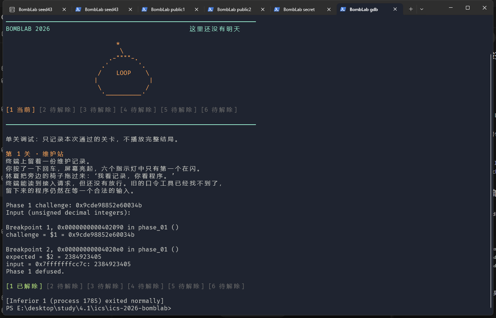
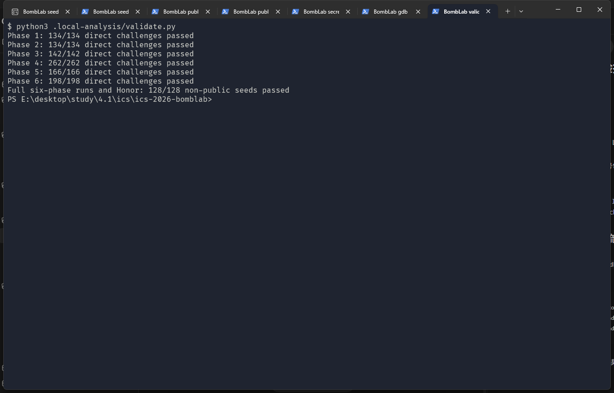

# Lab2：BombLab 实验报告

姓名：温祺荣　学号：23307110254

实验日期：2026 年 10 月 13 日

环境：Windows 上的 WSL2 Ubuntu，Linux x86-64，GCC、GNU binutils、GDB、Python 3.12。

## 完成情况与分析来源

正式六关和 Honor 均已实现。`make test` 的正式关卡结果为 **60/60**，Honor 为 **10/10**。另使用不在公开列表中的 seed `43` 完成七关，并进行了 1036 个直接 challenge 测试及 128 个非公开 seed 的完整六关与 Honor 测试，全部通过。这些是本地验证结果，不能代替助教的隐藏评测或最终成绩。

本次使用 Codex（AI）完成个人二进制的反汇编分析、求解代码实现、GDB 核对、测试执行和报告整理。下文记录的是 AI 辅助分析和实际运行证据，不声称是学生独立推导或亲自执行的过程；提交者仍需自行阅读、验证并能够解释代码。没有复制其他同学的代码或报告，没有修改炸弹数据、寄存器来绕过校验，也没有修改驱动、接口、测试或工作流。

个人炸弹由课程提供的 `fetch_bomb.py` 按学号领取并校验：

- package：`98cfaa6e4ed540536883b8ea`
- SHA-256：`a5fd87ccf307670b4a13138bc13331a9c6fdf33fe92667eba3b09c65c7ea09b1`

下文记 `C` 为当前关的 64 位 challenge，`lo32(x)` 为截取低 32 位。所有 32 位加、乘、异或及移位均用 `uint32_t` 恢复，按模 2³² 回绕；`C` 的移位先在 64 位上执行，再取低 32 位。`shr` 是逻辑右移，不能恢复为有符号算术右移。

## 第 1 关：函数调用与数据流

`phase_01` 要求一个整数，在 `0x4020db` 调用 `p1_compute`，然后在 `0x4020e0` 将返回的 `eax` 与输入比较。辅助函数中的关键指令为：

```asm
p1_step2: lea (%rdi,%rsi,8),%eax; xor $0xe614,%eax
p1_step0: lea (%rdi,%rdi,4),%eax; add %esi,%eax; xor $0x2e9e,%eax
p1_step1: lea (%rdi,%rdi,4),%eax; add $0x597,%esi; xor %esi,%eax
```

沿 `p1_compute` 的寄存器赋值和三次调用可恢复：

```text
L = lo32(C), H = lo32(C >> 32), M = lo32(C >> 16)
A = (H + 8*L) XOR 0xe614
B = (5*L + M) XOR 0x2e9e
answer = (5*B) XOR (A + 0x597)
```

这里 `lea` 计算整数表达式，并没有解引用内存。`ecx` 保存第一次调用结果，供最后一次调用作第二参数。GDB 用 seed `43` 在关卡入口观察到 `C=0x9cde98852e60034b`；停在比较指令时，`eax` 和输入内存均为 `2384923405`，继续运行输出 `Phase 1 defused.`。

## 第 2 关：数组与循环递推

`valid_u32_fields` 和 `sscanf` 的检查表明需要六个整数，数组位于 `rbp-0x40` 起。关键计算：

```asm
shr $0x1b,%rax; and $0xf,%eax       # 检查第一个数
mov $0xa,%ecx                     # 第一次循环移位量为 10
shr %cl,%rax; and $0x1f,%eax
add %esi,%eax
lea -0x7(%rcx),%esi; xor %esi,%eax
add $0x3,%ecx; add $0x4,%rdx
cmp $0x19,%ecx; jne ...            # 处理后面五项
```

首项为 `a[0]=(C>>27)&15`。循环每次将前一项与 challenge 的一段五位数相加，再异或随循环变化的值：

```text
对 i=1..5：a[i] = (a[i-1] + ((C >> (7+3*i)) & 31)) XOR (3*i)
```

因此不能将六项简单恢复成等差或等比数列。seed `43` 的六项为 `0 21 17 16 17 41`，炸弹验证通过。

## 第 3 关：跳转表与 switch

本关要求两个整数。第一项是 `C&7`，第二项由 `x=lo32(C>>3) XOR lo32(C>>32)` 经分支计算。`p3_dispatch` 的关键指令是：

```asm
cmp $0x7,%eax
ja ...
notrack jmp *0x405820(,%rax,8)
```

用 GDB 的 `x/8gx 0x405820` 读取八个入口，再追踪入口处的 `jmp p3_case_*`，确认**选择值与函数后缀不是相同顺序**，不能按函数名直接编号：

| 选择值 | 实际 case | 第二项计算 |
|---:|---:|---|
| 0 | 0 | `(2*x) XOR 0xb1a5` |
| 1 | 4 | `(x XOR 0x99d4) + (x>>1)` |
| 2 | 5 | `(4*x) XOR 0x1ecd` |
| 3 | 6 | `5*x + 0x24a22` |
| 4 | 3 | `5*x + 0x73c6` |
| 5 | 2 | `5*x + 0x42e6e` |
| 6 | 7 | `5*x + 0xf9ee` |
| 7 | 1 | `(x XOR 0x7a98) + (x>>1)` |

实现为 `phase3_case` 的 switch。seed `43` 输入为 `7 1288722246`，验证通过；额外测试覆盖全部八个选择值。

## 第 4 关：递归调用与返回

本关要求一个整数。入口设 `target=C&127`、`salt=lo32(C>>7) XOR lo32(C>>32)`，以 `[0,127]` 为搜索区间调用 `p4_walk`。关键指令：

```asm
sub %esi,%edi; shr $1,%edi; add %esi,%edi   # mid=low+(high-low)/2
cmp %eax,%edi; je ...                     # target==mid
cmp %edi,%eax; jb ...                     # target<mid，无符号比较
call p4_walk
lea (%rax,%rax,2),%eax                    # 返回值乘 3
xor %ebx,%eax                            # ebx=mid+salt
```

设递归函数为 `F(target,low,high,salt)`，则：

```text
mid = low + ((high-low) >> 1)
target == mid：返回 (mid+0xcc) XOR salt
target <  mid：返回 (3*F(target,low,mid-1,salt)) XOR (mid+salt) XOR 0x1c
target >  mid：返回 (3*F(target,mid+1,high,salt)) XOR (mid+salt) XOR 0x0f
```

异或常量是在子调用返回之后才参与运算，不能误写成递归参数。目标限制在 `[0,127]`，每次区间缩小，递归可以终止。seed `43` 的目标是 `127`，结果为 `3900907818`；额外测试覆盖全部 128 个目标，包括 `0` 和 `127`。

## 第 5 关：结构体和链表

`p5_traverse` 通过 `0x405b60(,%rax,8)` 读取链表起点，用 `mov (%rdx),%rdx` 沿 next 指针前进。节点布局由访存偏移确认：next 位于 `+0`（8 字节），id 位于 `+8`（4 字节），value 位于 `+12`（4 字节），每个节点共 16 字节。

```asm
mov 0x405b60(,%rax,8),%rdx        # heads[C&7]
mov 0x8(%rdx),%esi               # id
lea (%rax,%rax,2),%eax           # accumulator *= 3
add 0xc(%rdx),%eax               # 加 value
xor %esi,%eax                    # 异或 id
mov (%rdx),%rdx                  # 下一个节点
```

读取 `p5_nodes` 后，将地址恢复为从 `0x405ba0` 开始、步长 16 的节点下标，避免在求解程序里依赖炸弹的实际内存地址：

| 下标 | next 下标 | id | value |
|---:|---:|---:|---:|
| 0 | 1 | `0x374` | `0xd2da` |
| 1 | 6 | `0x877` | `0xfafe` |
| 2 | NULL | `0x116` | `0x1b48` |
| 3 | 7 | `0x70e` | `0x3610` |
| 4 | 9 | `0x61d` | `0xaf17` |
| 5 | 0 | `0x918` | `0xa2f5` |
| 6 | 8 | `0x04c` | `0x27a9` |
| 7 | 10 | `0xb84` | `0xca22` |
| 8 | 3 | `0x538` | `0xd8c2` |
| 9 | 11 | `0x43a` | `0x5890` |
| 10 | 2 | `0x25d` | `0xda59` |
| 11 | 5 | `0xa4c` | `0x4a40` |

八个起点对应下标 `[4,9,11,5,0,1,6,8]`。初始累加器为 `lo32(C>>6) XOR lo32(C>>32) XOR 0xa681`。先处理起点，然后再走 `(C>>3)&3` 次，每个节点执行 `acc=(3*acc+value) XOR id`。输出两项：最终累加器及最后访问节点的 id。特别注意总访问节点数是“步数加一”。

seed `43` 得到 `3598559736 2948`，验证通过。额外测试覆盖八个起点与四种步数的全部 32 种组合，合法路径均不触及 NULL。

## 第 6 关：函数指针与间接调用

本关要求一个整数，两次间接调用的关键指令为：

```asm
and $0x7,%eax; call *0x405e00(,%rax,8)
xor $0xd181,%eax
mov %eax,%edi; call *0x405e00(%rbx)
add $0x95af,%eax
```

第一次选择值为 `C&7`；`rbx` 经 `and $0x38` 后保存第二次调用的**字节偏移**，对应选择值 `(C>>3)&7`。GDB 读取八个指针，实际操作编号为 `[5,0,1,2,3,2,3,4]`，其中有重复项。

| 原操作编号 | 计算 |
|---:|---|
| 0 | `(x XOR 0xd14f) + 4*x` |
| 1 | `ROL32(x,5) XOR 0x1a65` |
| 2 | `((x<<5)+0xfe9e) XOR (3*x)` |
| 3 | `(x+0x47a9) XOR (x>>5)` |
| 4 | `(x XOR (x>>3))+0x99c6` |
| 5 | `ROR32(x,3)` |

令 `G(index,x)` 按上述指针表选择操作，恢复的完整关系为：

```text
x = lo32(C>>6) XOR lo32(C>>32)
first = G(C&7,x) XOR 0xd181
answer = G((C>>3)&7,first) + 0x95af
```

循环移位由无符号移位和按位或实现；用到的位数为 3、5、7，没有移位 32 位的情况。seed `43` 得到 `2022753061`，验证通过；额外测试覆盖两次调用的全部 64 种选择组合。

## Honor：结构体内相邻字段与上下文校验

Honor 需要前六行正确，并通过文件或管道提供第七行。驱动根据六行口令生成 context，传入 `solve_secret`；求解函数直接使用该参数，无需自己读取前六行或调用外部程序。

`secret_gate` 中关键指令：

```asm
lea -0xd0(%rbp),%r12
call secret_copy
cmpl $0x4e45504f,-0xb0(%rbp)
lea -0xac(%rbp),%rdi
call secret_phase
```

复制目标从 `rbp-0xd0` 开始，标志位与它相差 32 字节，数字字符串相差 36 字节。小端序的 `0x4e45504f` 对应 ASCII 字节 `OPEN`。因此第七行构造成 **32 个 A + OPEN + 三个无符号十进制整数**。`strlen` 的校验为 `length-36<=127`（无符号比较），允许长度为 36–163；当前输出最大长度为 68，终止符也在局部对象容量内。这里只利用题目指定的相邻字段布局，不覆盖返回地址或执行代码。

`secret_phase` 要求三项。记 `T` 为 context，`c=lo32(C) XOR lo32(C>>32)`，`t=lo32(T) XOR lo32(T>>32)`。关键计算包含 `and $3,%ecx`、`imul $0x3314,%ecx,%r9d`、`call secret_mix` 和 `shr $7,%esi`，恢复为：

```text
s = T & 3
b = ROR32(c XOR t,7) XOR 0xbed8 XOR (s*0x3314) XOR lo32(T>>16)
d = b XOR (t+s+0x8dcc+(c>>7))
数字部分为 s b d
```

在 seed `43` 的 GDB 观察中，Honor challenge 为 `0xe22a53d064a0b63a`，context 为 `0x6619d52799acece3`。复制后标志字为 `0x4e45504f`，传入 `secret_phase` 的字符串为 `3 2312487408 2299993262`。继续执行输出 `Secret phase defused.`。调试仅使用断点和读取命令，没有修改炸弹内的变量、寄存器或内存。

## 验证记录

公开 seed 列表为 `0,1,7,42,99,123,2026,65535,987654321,18446744073709551615`，其中没有 `43`。seed `43` 的实际输入与结果如下，满足每个已完成关卡至少一次在公开列表之外验证的要求：

| 关卡 | 输入 | 结果 |
|---|---|---|
| 1 | `2384923405` | `Phase 1 defused.` |
| 2 | `0 21 17 16 17 41` | `Phase 2 defused.` |
| 3 | `7 1288722246` | `Phase 3 defused.` |
| 4 | `3900907818` | `Phase 4 defused.` |
| 5 | `3598559736 2948` | `Phase 5 defused.` |
| 6 | `2022753061` | `Phase 6 defused.` |
| Honor | 32 个 A，接 `OPEN3 2312487408 2299993262` | `Secret phase defused.` |

可复现命令：

```sh
make
make test
{ ./defuser --seed 43; ./defuser --secret --seed 43; } | ./bomb --seed 43
```

下列图片是**真实运行输出的排版截图**：从本地实际命令输出直接渲染，没有伪造终端窗口、补写通关文字或修改测试结果。






额外直接 challenge 测试：各关分别通过 `134/134`、`134/134`、`142/142`、`262/262`、`166/166`、`198/198`，共 1036 项。输入包括 `0`、`1`、`0xffffffff`、`0x100000000`、`0x8000000000000000`、`0xffffffffffffffff`，每关另含 128 个固定随机源生成的 challenge，并增加上述分支覆盖输入。随机源使用 `random.Random(23307110254)`；后续从同一随机源选择 128 个不在公开列表中的 seed（包含 `43` 和 `23307110254`），逐个检查完整六关及 Honor，全部通过。测试不替换课程的公开测试程序，额外脚本、完整反汇编、调试日志和编译产物不作为提交文件。

## 参考资料与工具用途

1. [课程 Lab2 文档](https://ics-26fall-fdu.github.io/labs/lab2-bomb-lab/)：求解接口、格式、GDB 操作、测试和提交要求。
2. [课程 BombLab 模板](https://github.com/ICS-26Fall-FDU/BombLab)：README、接口、公开测试及 tutor 教学。教学关卡 `make test-tutor` 通过 `10/10`，不计入正式关卡。
3. 本人的原始 `bomb`：所有个人常量、跳转表、节点数据和函数指针均从此二进制读取，没有用其他同学的解法。
4. `objdump -d --no-show-raw-insn`：导出并阅读指令；GDB：读取静态数据表，在入口和比较指令处观察参数、内存与返回值；GCC 与课程测试脚本：编译和运行验证。
5. Codex（AI）：反汇编解释、计算关系恢复、代码实现、测试设计与执行、报告组织；使用范围已在报告开头说明。图片用浏览器渲染真实输出生成，便于阅读。
