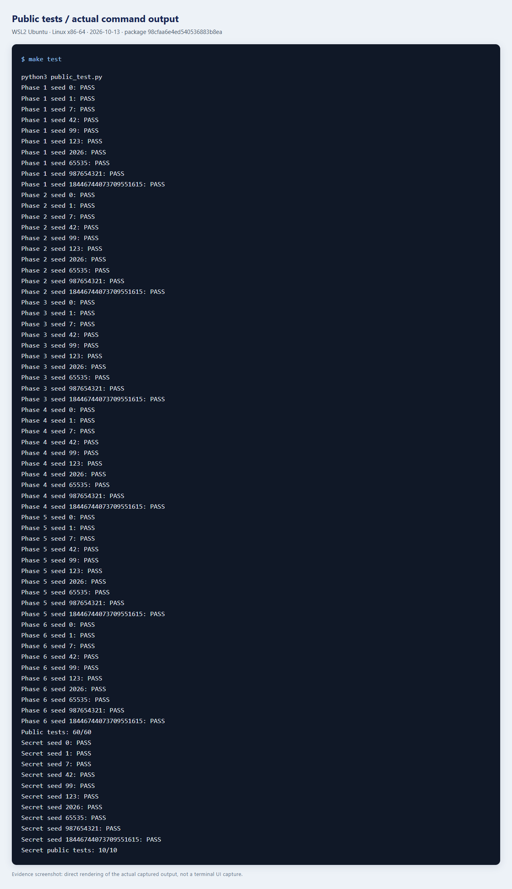
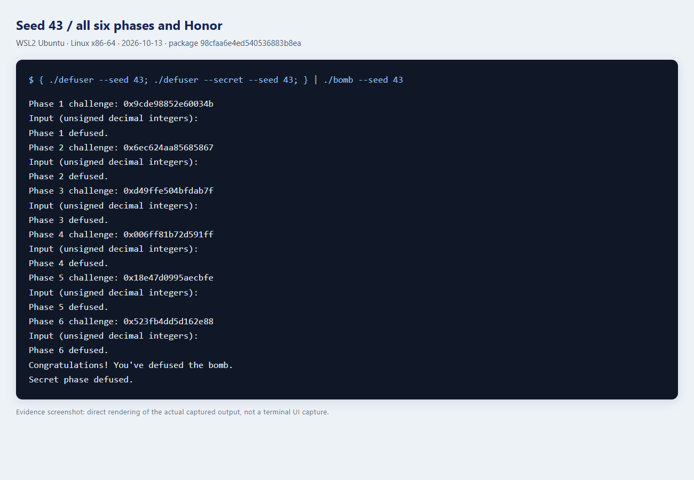

# Lab2：BombLab 实验报告

姓名：温祺荣　学号：23307110254

实验日期：2026 年 10 月 13 日

环境：Windows 上的 WSL2 Ubuntu，Linux x86-64，GCC、GNU binutils、GDB、Python 3.12。

个人炸弹通过 `fetch_bomb.py` 按学号领取。六个正式关卡及 Honor 均已完成，公开测试分别通过 `60/60` 和 `10/10`。下面按关卡说明计算过程，最后列出测试记录和截图。

下文用 `C` 表示当前关卡的 challenge，`lo32(x)` 表示取低 32 位。汇编中的 32 位运算对应 C 代码中的 `uint32_t`，溢出时保留低 32 位。对 challenge 的移位先按 64 位执行，再截取结果。

## 第 1 关：函数调用与数据流

`phase_01` 要求一个整数，在 `0x4020db` 调用 `p1_compute`，然后在 `0x4020e0` 将返回的 `eax` 与输入比较。辅助函数中的关键指令为：

```asm
p1_step2: lea (%rdi,%rsi,8),%eax; xor $0xe614,%eax
p1_step0: lea (%rdi,%rdi,4),%eax; add %esi,%eax; xor $0x2e9e,%eax
p1_step1: lea (%rdi,%rdi,4),%eax; add $0x597,%esi; xor %esi,%eax
```

`p1_compute` 先调用 `p1_step2`，把结果保存在 `ecx`；再调用 `p1_step0`，最后将这两个结果传给 `p1_step1`。按这个顺序，计算关系为：

```text
L = lo32(C), H = lo32(C >> 32), M = lo32(C >> 16)
A = (H + 8*L) XOR 0xe614
B = (5*L + M) XOR 0x2e9e
answer = (5*B) XOR (A + 0x597)
```

这里的 `lea` 用于计算乘法与加法，不是在读取内存。用 seed `43` 在 GDB 中停到比较指令时，`eax` 和输入内存的值都是 `2384923405`，与公式计算结果一致。

## 第 2 关：数组与循环递推

`valid_u32_fields` 和 `sscanf` 的检查表明需要六个整数，数组位于 `rbp-0x40` 起。关键计算：

```asm
shr $0x1b,%rax; and $0xf,%eax       # 检查第一个数
mov $0xa,%ecx                     # 第一次循环移位量为 10
shr %cl,%rax; and $0x1f,%eax
add %esi,%eax
lea -0x7(%rcx),%esi; xor %esi,%eax
add $0x3,%ecx; add $0x4,%rdx
cmp $0x19,%ecx; jne ...            # 处理后面五项
```

首项为 `a[0]=(C>>27)&15`。循环每次将前一项与 challenge 的一段五位数相加，再异或随循环变化的值：

```text
对 i=1..5：a[i] = (a[i-1] + ((C >> (7+3*i)) & 31)) XOR (3*i)
```

循环中的移位量依次为 `10、13、16、19、22`，异或值依次为 `3、6、9、12、15`。依次计算并保存六项即可。

## 第 3 关：跳转表与 switch

本关要求两个整数。第一项是 `C&7`，第二项由 `x=lo32(C>>3) XOR lo32(C>>32)` 经分支计算。`p3_dispatch` 的关键指令是：

```asm
cmp $0x7,%eax
ja ...
notrack jmp *0x405820(,%rax,8)
```

用 `x/8gx 0x405820` 查看跳转表，再跟到各入口处的 `jmp p3_case_*`，得到下表。表项顺序与函数名后缀不同，求解时需要按实际选择值写 switch。

| 选择值 | 实际 case | 第二项计算 |
|---:|---:|---|
| 0 | 0 | `(2*x) XOR 0xb1a5` |
| 1 | 4 | `(x XOR 0x99d4) + (x>>1)` |
| 2 | 5 | `(4*x) XOR 0x1ecd` |
| 3 | 6 | `5*x + 0x24a22` |
| 4 | 3 | `5*x + 0x73c6` |
| 5 | 2 | `5*x + 0x42e6e` |
| 6 | 7 | `5*x + 0xf9ee` |
| 7 | 1 | `(x XOR 0x7a98) + (x>>1)` |

## 第 4 关：递归调用与返回

本关要求一个整数。入口设 `target=C&127`、`salt=lo32(C>>7) XOR lo32(C>>32)`，以 `[0,127]` 为搜索区间调用 `p4_walk`。关键指令：

```asm
sub %esi,%edi; shr $1,%edi; add %esi,%edi   # mid=low+(high-low)/2
cmp %eax,%edi; je ...                     # target==mid
cmp %edi,%eax; jb ...                     # target<mid，无符号比较
call p4_walk
lea (%rax,%rax,2),%eax                    # 返回值乘 3
xor %ebx,%eax                            # ebx=mid+salt
```

设递归函数为 `F(target,low,high,salt)`，则：

```text
mid = low + ((high-low) >> 1)
target == mid：返回 (mid+0xcc) XOR salt
target <  mid：返回 (3*F(target,low,mid-1,salt)) XOR (mid+salt) XOR 0x1c
target >  mid：返回 (3*F(target,mid+1,high,salt)) XOR (mid+salt) XOR 0x0f
```

它的搜索过程类似二分查找，但返回值还要逐层乘 3，再与 `mid+salt` 和分支常量异或。因此答案不仅取决于命中的位置，也取决于递归经过的路径。目标在 `[0,127]` 内，每次递归缩小区间，最终都会命中。

## 第 5 关：结构体和链表

`p5_traverse` 通过 `0x405b60(,%rax,8)` 读取链表起点，用 `mov (%rdx),%rdx` 沿 next 指针前进。节点布局由访存偏移确认：next 位于 `+0`（8 字节），id 位于 `+8`（4 字节），value 位于 `+12`（4 字节），每个节点共 16 字节。

```asm
mov 0x405b60(,%rax,8),%rdx        # heads[C&7]
mov 0x8(%rdx),%esi               # id
lea (%rax,%rax,2),%eax           # accumulator *= 3
add 0xc(%rdx),%eax               # 加 value
xor %esi,%eax                    # 异或 id
mov (%rdx),%rdx                  # 下一个节点
```

用 GDB 读取 `p5_heads` 和 `p5_nodes`，将从 `0x405ba0` 开始的 12 个节点按地址编号为 `0..11`，再将 next 指针改写为对应下标。八个起点的下标为 `[4,9,11,5,0,1,6,8]`，由 `C&7` 选择。

初始累加器为 `lo32(C>>6) XOR lo32(C>>32) XOR 0xa681`。先处理起点，再沿 next 指针走 `(C>>3)&3` 次，每个节点执行：

```text
acc = (3*acc + value) XOR id
```

最后输出累加器和最后访问节点的 id。循环之外已经处理过起点，所以步数为 0 时也会访问一个节点。

以 seed `43` 为例，起点下标为 `6`，步数为 `3`，访问顺序是 `6→8→3→7`。最后一个节点的 id 是 `0xb84`，即十进制 `2948`，对应口令的第二项。

## 第 6 关：函数指针与间接调用

本关要求一个整数，两次间接调用的关键指令为：

```asm
and $0x7,%eax; call *0x405e00(,%rax,8)
xor $0xd181,%eax
mov %eax,%edi; call *0x405e00(%rbx)
add $0x95af,%eax
```

第一次选择值为 `C&7`；`rbx` 经 `and $0x38` 后保存第二次调用的字节偏移，换成表下标就是 `(C>>3)&7`。读取八个函数指针，实际操作编号依次为 `[5,0,1,2,3,2,3,4]`。

| 原操作编号 | 计算 |
|---:|---|
| 0 | `(x XOR 0xd14f) + 4*x` |
| 1 | `ROL32(x,5) XOR 0x1a65` |
| 2 | `((x<<5)+0xfe9e) XOR (3*x)` |
| 3 | `(x+0x47a9) XOR (x>>5)` |
| 4 | `(x XOR (x>>3))+0x99c6` |
| 5 | `ROR32(x,3)` |

令 `G(index,x)` 按上述指针表选择操作，恢复的完整关系为：

```text
x = lo32(C>>6) XOR lo32(C>>32)
first = G(C&7,x) XOR 0xd181
answer = G((C>>3)&7,first) + 0x95af
```

`rol` 和 `ror` 对应 32 位循环移位，用无符号左移、右移和按位或组合实现。第二次调用使用第一次的计算结果，不能把两个操作分别应用到最初的 `x` 上。

## Honor：结构体内相邻字段与上下文校验

Honor 在前六关通过后读取第七行。驱动根据前六行口令计算 context，并与 Honor 的 challenge 一起传给 `solve_secret`。

`secret_gate` 中关键指令：

```asm
lea -0xd0(%rbp),%r12
call secret_copy
cmpl $0x4e45504f,-0xb0(%rbp)
lea -0xac(%rbp),%rdi
call secret_phase
```

复制目标从 `rbp-0xd0` 开始，标志位与它相差 32 字节，数字字符串相差 36 字节。比较常量 `0x4e45504f` 按小端序排列就是 `OPEN`。因此第七行用 32 个 A 填充开头，接上 `OPEN`，再接三个整数。`strlen` 的检查允许长度为 36–163；构造的输入最多 59 字节，在允许范围内。

`secret_phase` 要求三项。记 `T` 为 context，`c=lo32(C) XOR lo32(C>>32)`，`t=lo32(T) XOR lo32(T>>32)`。关键计算包含 `and $3,%ecx`、`imul $0x3314,%ecx,%r9d`、`call secret_mix` 和 `shr $7,%esi`，恢复为：

```text
s = T & 3
b = ROR32(c XOR t,7) XOR 0xbed8 XOR (s*0x3314) XOR lo32(T>>16)
d = b XOR (t+s+0x8dcc+(c>>7))
数字部分为 s b d
```

用 seed `43` 在 GDB 中观察，Honor challenge 为 `0xe22a53d064a0b63a`，context 为 `0x6619d52799acece3`。复制后标志字确实变为 `0x4e45504f`，传入 `secret_phase` 的字符串为 `3 2312487408 2299993262`，继续执行后通关。

## 验证记录

`make test` 的正式关卡结果为 `60/60`，Honor 为 `10/10`。另外选用不在 `tests/public.json` 中的 seed `43` 验证，七关输入和结果如下：

| 关卡 | 输入 | 结果 |
|---|---|---|
| 1 | `2384923405` | `Phase 1 defused.` |
| 2 | `0 21 17 16 17 41` | `Phase 2 defused.` |
| 3 | `7 1288722246` | `Phase 3 defused.` |
| 4 | `3900907818` | `Phase 4 defused.` |
| 5 | `3598559736 2948` | `Phase 5 defused.` |
| 6 | `2022753061` | `Phase 6 defused.` |
| Honor | 32 个 A，接 `OPEN3 2312487408 2299993262` | `Secret phase defused.` |

可复现命令：

```sh
make
make test
{ ./defuser --seed 43; ./defuser --secret --seed 43; } | ./bomb --seed 43
```

下面两张图由实际运行日志渲染，分别记录公开测试和 seed `43` 的结果。





额外测试使用 `random.Random(23307110254)` 生成输入，并加入边界值和各关分支组合。各关分别通过 `134、134、142、262、166、198` 个直接 challenge，共 1036 项。其中第 3 关覆盖八个分支，第 4 关覆盖全部 128 个目标，第 5 关覆盖 32 种起点与步数组合，第 6 关覆盖 64 种函数选择组合。另有 128 个非公开 seed 完成六关及 Honor，均通过。

[第 1 关 GDB 观察记录](images/gdb-phase1.png) · [额外测试结果](images/validation.png)

## 参考资料与工具说明

参考了[课程 Lab2 文档](https://ics-26fall-fdu.github.io/labs/lab2-bomb-lab/)及[BombLab 模板中的 README 和 tutor 教学](https://github.com/ICS-26Fall-FDU/BombLab)。个人常量、跳转表和链表数据均来自按本学号领取的 `bomb`。

分析使用 `objdump` 查看汇编、GDB 读取数据表和核对运行值，测试使用 GCC 和课程提供的脚本。本次反汇编分析、求解代码、测试执行及报告整理由 Codex（AI）完成，报告中的计算关系和结果据此记录。
